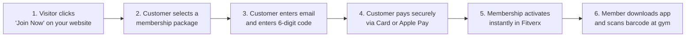

# Fitverx Website Checkout — Gym Owner & Website Integration Manual

**Audience:** Gym Owners, General Managers, Marketing Directors, and Website Administrators.  
**No programming or technical background required.**

---

## 1. Welcome to Fitverx Website Checkout

### What is Fitverx Website Checkout?
Fitverx Website Checkout allows you to sell gym memberships, class passes, and personal training packages directly through your existing gym website. 

Instead of asking visitors to visit your front desk in person or download a mobile app just to see your prices, you can place a simple **"Join Now"** button or checkout widget directly on your website.

### The Big Advantage: Keep Your Existing Website
You do **not** need to rebuild your website, switch website hosting companies, or hire expensive web programmers. Fitverx handles the entire purchase process:
1. Displaying your membership packages and prices.
2. Verifying the customer's email address.
3. Securely processing their credit card, Apple Pay, or Google Pay.
4. Automatically activating their membership in your Fitverx system.
5. Sending them an instant invite to download the Fitverx mobile app so they can check in at your front desk immediately.

---

## 2. How the System Works

Here is the simple, step-by-step journey from a visitor landing on your website to walking through your gym doors:



1. **Ad or Website Visit**: A prospective member visits your gym's website (often after clicking a Facebook, Instagram, or Google ad).
2. **Package Selection**: They click **"Join Now"** or view your pricing section, where your active membership packages are displayed.
3. **Email Verification**: The customer enters their name and email address. Fitverx sends them a secure 6-digit verification code to confirm they own the email address.
4. **Secure Payment**: The customer enters the 6-digit code and completes their payment through a secure payment screen powered by Stripe (Credit Card, Debit Card, Apple Pay, or Google Pay).
5. **Instant Membership Activation**: The moment the payment goes through, Fitverx automatically creates their member profile, activates their membership, and allocates their credits.
6. **Mobile App Handover**: The customer creates their password on the confirmation screen and is invited to download the Fitverx mobile app. They can now open the app, book classes, and scan their digital barcode at your front desk scanner.

---

## 3. Before You Start

Make sure you have the following ready before setting up your website checkout:

- **An Active Fitverx Gym Account**: Your gym must be registered on the Fitverx platform.
- **Configured Membership Packages**: You must have at least one active membership package set up with a name, price, and duration.
- **A Connected Stripe Account**: Your gym must have completed payment onboarding in Fitverx so that customer funds deposit directly into your gym's bank account.
- **Website Access**: You or your website manager will need permission to edit your website (e.g., access to your WordPress, Squarespace, Wix, or custom website editor).
- **Your Gym's Web Identifier**: This is your gym's short identifier in Fitverx (for example: `irontemple` or `downtownfitness`).

---

## 4. Step-by-Step Website Integration

### Step 1: Check Your Membership Packages
Before connecting your website, make sure your membership packages are configured the way you want customers to see them:
1. Log into your **Fitverx Admin Dashboard**.
2. Go to **Settings > Membership Packages**.
3. Verify that each package you want to sell online has:
   - A clear **Name** (e.g., *Unlimited Monthly Membership* or *10-Class Pack*).
   - An accurate **Price** and **Billing Frequency** (e.g., *$99.00 billed monthly*).
   - A **Duration** (e.g., *Valid for 30 days*).
   - **Status set to Active**: Only active packages appear on your website. Inactive or archived packages are automatically hidden.

---

### Step 2: Open Website Integration Settings
In your Fitverx dashboard, navigate to **Settings > Online Checkout**:
- **Enable Online Checkout**: Switch this toggle to **ON**. (By default, online checkout is disabled until you turn it on).
- **Branding & Colors**: Choose your primary gym brand color (e.g., `#1A56DB`). This color will be applied to buttons and highlights on your checkout screen.
- **Upload Your Logo**: Ensure your gym logo is uploaded so customers see your brand throughout checkout.
- **Success & Cancel Links (Optional)**: You can specify where customers are sent if they cancel checkout (such as your homepage).

---

### Step 3: Get Your Integration Link & Code

Fitverx gives you two simple ways to add checkout to your website:

#### Option A: Direct Button Link *(Easiest & Recommended)*
Add a "Join Now" button anywhere on your website that links directly to your dedicated checkout page:
```html
<a href="https://checkout.fitverx.com/?gym=YOUR_GYM_SUBDOMAIN" class="join-button">
  Join Now
</a>
```
*(Replace `YOUR_GYM_SUBDOMAIN` with your gym's actual identifier, e.g., `irontemple`).*

#### Option B: Embeddable Web Widget
If you want the membership cards and checkout flow embedded directly inside your existing webpage, paste this code into your website where you want the checkout to appear:
```html
<!-- Fitverx Website Checkout Widget -->
<div id="fitverx-checkout-container" data-gym="YOUR_GYM_SUBDOMAIN"></div>
<script src="https://checkout.fitverx.com/widget.js" async></script>
```

---

### Step 4: Adding the Code to Your Website Platform

#### If Your Website is Built with WordPress:
1. Log into your WordPress Admin Dashboard.
2. Navigate to **Pages** and click **Edit** on your Pricing or Membership page.
3. If using the WordPress Block Editor (Gutenberg):
   - Click the **+** button to add a new block.
   - Search for **Custom HTML** or **Buttons**.
   - If using a button: paste your Option A link into the button URL.
   - If using the widget: paste the Option B code snippet into the Custom HTML block.
4. Click **Update** to publish your changes.

#### If Your Website is Built with Squarespace, Wix, or Webflow:
1. Open your website page editor.
2. Add an **Embed** or **Code** element to the section where you want memberships to appear.
3. Paste the integration code.
4. Click **Publish**.

#### If You Have an External Web Designer:
Simply email them this message:
> *"Hi! We are adding online membership checkout to our website using Fitverx. Please add a 'Join Now' button linking to `https://checkout.fitverx.com/?gym=YOUR_GYM_SUBDOMAIN` on our pricing page."*

---

### Step 5: Test Your Integration
Always run a quick test before announcing online memberships to the public:
1. Open your website in a new browser window (or on your phone).
2. Click your new **Join Now** button.
3. Verify that your gym name and logo appear at the top.
4. Check that your packages and prices match what you configured in Fitverx.
5. Enter a test email address you own and verify that you receive the 6-digit confirmation code.

---

## 5. How Customers Experience Checkout

Here is what your customer sees and does during checkout:

1. **Viewing Your Packages**: When the customer opens the checkout page, they see clean cards showing your package name, price, number of class credits, and validity period.
2. **Entering Their Information**: They choose a package and enter their First Name, Last Name, Email Address, and Phone Number.
3. **6-Digit Email Verification**: 
   - Within seconds, a clean email arrives in their inbox containing a 6-digit code.
   - The customer enters the code on the screen.
   - *Why this happens*: This prevents mistyped email addresses, stops spam bots, and ensures every member can be reached by your staff.
4. **Fast, Secure Payment**:
   - The customer enters their card details or uses **Apple Pay** / **Google Pay** with a single tap.
   - Payment is processed through Stripe's banking-grade security.
5. **Instant Confirmation & Password Setup**:
   - Once payment is confirmed, the screen shows a green success badge with their receipt.
   - The screen invites them to choose a password for the Fitverx mobile app.
6. **Mobile App Access**:
   - Direct download buttons for the Apple App Store and Google Play Store appear on the screen.
   - The customer opens the app, enters their email and password, and immediately sees their membership and check-in barcode.

---

## 6. What Happens After a Customer Pays?

| Area | What Happens Automatically |
| :--- | :--- |
| **Your Bank Account** | The customer's payment is deposited into your connected bank account according to your standard payout schedule. |
| **Fitverx Member Roster** | A new member profile is created in your Fitverx dashboard under **Members**, complete with their name, email, and phone number. |
| **Membership & Credits** | Their purchased package is marked **Active**, and their class credits are loaded into their account immediately. |
| **Existing Fitverx Members** | If the customer already has a Fitverx account at another gym, Fitverx safely links their existing profile to your gym without creating a confusing duplicate login. |
| **Customer Email** | A receipt and welcome email is sent to the customer with instructions on downloading the mobile app. |
| **Front Desk Scanner** | The member can open their Fitverx mobile app and scan their digital barcode at your front desk scanner right away. |

---

## 7. Common Questions & Troubleshooting

### Why are my membership packages not showing up?
- **Cause 1**: The package in your dashboard may be set to inactive. Go to **Settings > Membership Packages** and verify that **Status** is set to **Active**.
- **Cause 2**: Online checkout may be turned off. Go to **Settings > Online Checkout** and confirm that **Enable Online Checkout** is switched **ON**.

### What if a customer says they didn't get their 6-digit verification code?
1. Ask the customer to check their **Spam** or **Promotions** folder.
2. Ask them to verify that they spelled their email address correctly.
3. The checkout screen has a **"Resend Code"** button that becomes clickable after 60 seconds. They can click it to send a fresh code.

### What if a customer types the wrong verification code too many times?
To prevent automated hacking attempts, Fitverx allows 5 attempts. If a customer enters the wrong code 5 times, the screen will ask them to click **"Resend Code"** to receive a brand new code.

### What happens if a customer's payment fails?
If their card is declined or has insufficient funds, the screen clearly informs them: *"Your payment was not completed. Please try another card."* No membership is created, and the customer can immediately try a different payment method without having to re-enter their email or verification code.

### What if an existing member buys a package online?
Fitverx automatically recognizes their email address. It will not create a duplicate member profile. Instead, it adds the newly purchased package to their existing Fitverx account. When they open their mobile app, their new credits will be ready to use.

---

## 8. Frequently Asked Questions (FAQ)

#### Do I need to replace or redesign my existing gym website?
**No.** Fitverx checkout works with any existing website. You simply add a button or link.

#### Can customers buy memberships from their smartphones?
**Yes.** The checkout page is fully optimized for mobile devices and supports **Apple Pay** and **Google Pay** for quick, one-touch purchases.

#### Can I change package prices later?
**Yes.** Any changes you make to package names or prices in your Fitverx dashboard update on your website checkout automatically.

#### How do new members check in at my gym?
After purchasing online, the customer downloads the **Fitverx** app from the App Store or Google Play. They log in with their email and the password they created at checkout. The app generates their personal check-in barcode.

#### Is customer payment information secure?
**Yes.** All payments are processed through Stripe, a certified PCI Level 1 Service Provider (the highest level of security certification in the payments industry). Fitverx never sees or stores full credit card numbers.

---

## 9. Final Launch Checklist

Before launching your online checkout to the public, check off each step:

- [ ] Online Checkout is toggled **ON** in your Fitverx settings.
- [ ] Your membership packages are set to **Active** with correct prices and credit amounts.
- [ ] Your gym logo and brand color are configured in Fitverx settings.
- [ ] Your "Join Now" button or widget has been added to your website.
- [ ] You have clicked the button on your website to verify that it opens your gym's checkout page.
- [ ] You have completed a test purchase to verify the email code and confirmation screen.
- [ ] You are ready to start selling memberships online!

