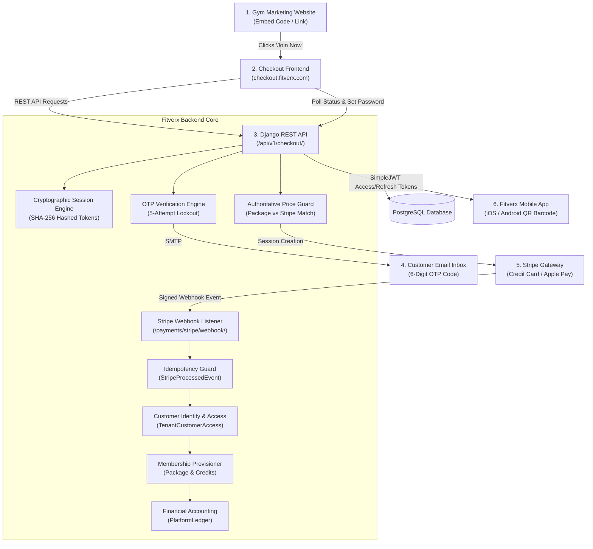
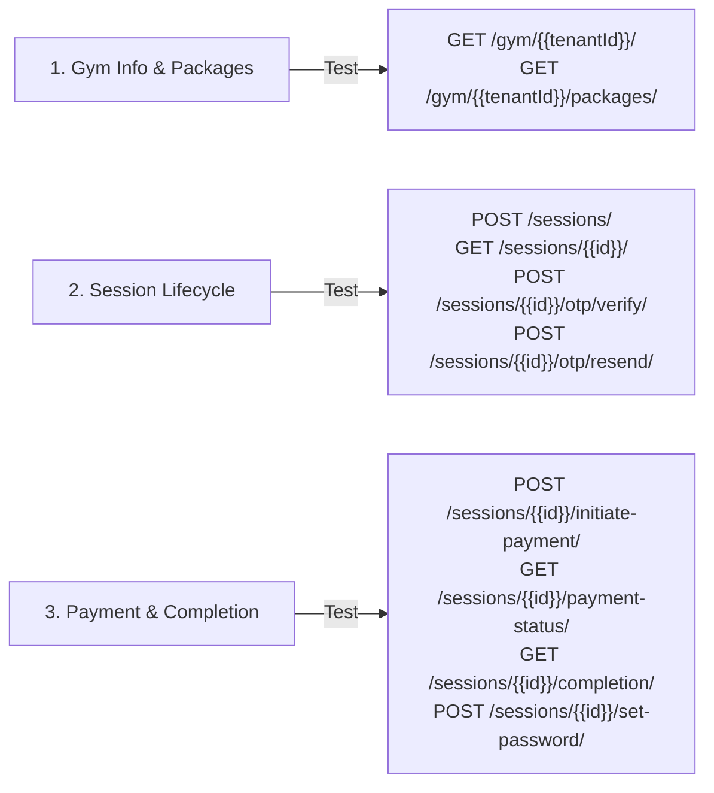

# Fitverx Website Checkout — QA Testing & Validation Manual

**Audience:** QA Engineers, System Testers, and Validation Leads.  
**API Collection Reference:** [`docs/fitverx_checkout_postman_collection.json`](file:///Users/ansmustafa/gym-app-backend/docs/fitverx_checkout_postman_collection.json)  
**Backend API Base URL:** `https://api.fitverx.com/api/v1/checkout` (Local Test: `http://localhost:8000/api/v1/checkout`)  
**Test Suite File:** [`apps/payments/tests_checkout_integration.py`](file:///Users/ansmustafa/gym-app-backend/apps/payments/tests_checkout_integration.py)

---

## 1. Introduction

### What is the Fitverx Website Checkout Integration?
Fitverx Website Checkout is an automated, web-first e-commerce capability that allows gym owners to sell recurring memberships and class packages directly from their existing marketing websites. 

### Why Was It Built & What Problem Does It Solve?
Gym marketing funnels typically run ads to landing pages on platforms like WordPress, Webflow, or Squarespace. Forcing prospects to download a mobile app before making a payment creates significant friction and drastically lowers conversion rates. Conversely, building bespoke shopping carts results in disjointed billing that does not synchronize with the gym's check-in turnstiles, attendance tracking, or class booking schedules.

Fitverx Website Checkout solves this by providing:
1. Public, embeddable package discovery with server-side price protection.
2. Lightweight email ownership verification via OTP (preventing fraudulent registrations and spam).
3. PCI-compliant Stripe payment processing (supporting Credit Cards, Apple Pay, and Google Pay).
4. Automated customer account provisioning and active membership entitlement creation upon payment receipt.
5. Immediate mobile application handover so new members can attend classes and access facilities right away.

### Expected Business Outcome
- **Zero Friction Lead Conversion**: Prospects convert on the web in under 2 minutes.
- **Accurate Financial Records**: Automatic fee splitting and ledger recording between the gym and Fitverx platform.
- **Zero Manual Admin Work**: Gym staff do not need to create member accounts, manually assign credits, or email receipts.

---

## 2. Complete System Architecture & Information Flow



---

## 3. Comprehensive User Stories & Validation Criteria

### Category A: Gym Owner Stories

#### US-OWN-01: Gym Owner Makes Membership Packages Available for Online Purchase
- **Preconditions**: Gym owner is logged into the Fitverx Admin Portal for their gym (`alpha`).
- **User Actions**: Owner navigates to *Packages*, selects a package (e.g., "Monthly Unlimited"), and ensures `is_active=True`.
- **Backend Behaviour**: `PackageType` row is verified with valid `price`, `validity_days`, and linked `stripe_price_id`.
- **Expected Outcome**: Calling `GET /api/v1/checkout/gym/alpha/packages/` returns this package in the JSON list.
- **Pass/Fail Criteria**: Pass if active packages appear with accurate prices; fail if inactive packages are exposed.

#### US-OWN-02: Gym Owner Enables Website Checkout for Their Gym
- **Preconditions**: `TenantCheckoutConfig` exists for tenant `alpha`.
- **User Actions**: Gym owner toggles "Enable Online Checkout" in the settings.
- **Backend Behaviour**: Updates `TenantCheckoutConfig.is_enabled = True`.
- **Expected Outcome**: Calling `GET /api/v1/checkout/gym/alpha/` returns HTTP 200 with branding and settings.
- **Pass/Fail Criteria**: Pass if `is_enabled=False` returns HTTP 404 and `is_enabled=True` returns HTTP 200.

---

### Category B: New Customer Stories

#### US-CUST-01: New Customer Discovers Gym, Selects Package, and Receives OTP
- **Preconditions**: Customer has an email (`new_member@example.com`) not currently registered in Fitverx.
- **User Actions**: Visits checkout frontend $\to$ selects package $\to$ enters name, email, and phone number $\to$ clicks "Continue".
- **Frontend Behaviour**: Sends `POST /sessions/`, stores `session_token` in `sessionStorage`, and transitions to the OTP entry screen.
- **Backend Behaviour**:
  1. Validates that package belongs to requested gym.
  2. Creates an `ExternalCheckoutSession` record in database with status `PENDING_VERIFICATION`.
  3. Hashes the raw token with SHA-256 and stores only the hash in `token_hash`.
  4. Generates a 6-digit OTP, stores `otp_hash`, sets `otp_expires_at = now() + 5 min`.
  5. Sends email with code.
- **Expected Database State**:
  - `ExternalCheckoutSession`: `status = 'PENDING_VERIFICATION'`, `is_verified = False`, `token_hash = sha256(raw_token)`.
- **Pass/Fail Criteria**: Pass if email arrives within 5 seconds and raw token cannot be found in database plain text.

#### US-CUST-02: New Customer Enters Correct OTP
- **Preconditions**: Session in `PENDING_VERIFICATION` state.
- **User Actions**: Customer enters the 6-digit code received via email.
- **Frontend Behaviour**: Sends `POST /sessions/{id}/otp/verify/` with `X-Checkout-Token`.
- **Backend Behaviour**: Compares `sha256(code)` with `session.otp_hash`. Updates session status to `READY_FOR_PAYMENT` and `is_verified = True`.
- **Pass/Fail Criteria**: Pass if HTTP 200 is returned and `is_verified` becomes `True` in database.

#### US-CUST-03: New Customer Completes Payment & Sets Mobile App Password
- **Preconditions**: Session in `READY_FOR_PAYMENT` state.
- **User Actions**:
  1. Clicks "Proceed to Payment" $\to$ completes payment on Stripe with test card `4242...` $\to$ returns to order summary.
  2. Enters password: `SecurePassword123!` $\to$ submits.
- **Backend Behaviour**:
  1. Stripe webhook fulfills payment: creates `User` (role `CLIENT`), creates `TenantCustomerAccess`, creates active `Package`, writes `PlatformLedger`.
  2. Password endpoint updates `User.password`, marks unusable password as false, and returns SimpleJWT tokens.
- **Expected Database State**:
  - `ExternalCheckoutSession.status`: `'COMPLETED'`
  - `ExternalCheckoutSession.payment_status`: `'paid'`
  - `Package.credits_remaining`: Equals package credit count.
  - `TenantCustomerAccess`: Exists for `(user, tenant, role='CLIENT', is_active=True)`.
  - `PlatformLedger`: Transaction row exists with tenant gross and platform fee.
- **Pass/Fail Criteria**: Pass if user can immediately authenticate to `/api/v1/token/` using the new password.

---

### Category C: Existing Customer Stories

#### US-EXIST-01: Existing Fitverx Customer Buys Membership at a New Gym
- **Preconditions**: User `existing_member@example.com` already has an account at Gym A.
- **User Actions**: Visits Gym B checkout $\to$ enters `existing_member@example.com` $\to$ verifies OTP $\to$ completes payment.
- **Backend Behaviour**:
  1. Detects `User` already exists with this email.
  2. Does **not** attempt to create a duplicate `User` row (which would violate `User.email` unique constraint).
  3. Creates a new `TenantCustomerAccess` linking this user to Gym B.
  4. Provisions active `Package` for Gym B.
  5. Completion API returns `needs_password_setup: false`.
- **Pass/Fail Criteria**: Pass if only 1 `User` row exists in the database, with two `TenantCustomerAccess` rows (one for Gym A, one for Gym B).

---

### Category D: Failure, Security & Exception Stories

#### US-ERR-01: Customer Enters Incorrect OTP 5 Times (Brute-Force Lockout)
- **Preconditions**: Active session with pending OTP.
- **User Actions**: Customer enters invalid OTP `000000` five times consecutively.
- **Backend Behaviour**:
  - Attempts 1–4: Returns HTTP 400 (`"Invalid verification code."`), increments `session.otp_attempts`.
  - Attempt 5: Returns HTTP 400 (`"Maximum verification attempts exceeded. Please request a new code."`).
  - Attempt 6+: Blocked immediately without checking code.
- **Pass/Fail Criteria**: Pass if 5th failed attempt permanently blocks verification until a new code is requested via `otp/resend/`.

#### US-ERR-02: Customer Requests OTP Resend Before 60-Second Cooldown Expires
- **Preconditions**: OTP dispatched at timestamp $T$.
- **User Actions**: Customer clicks "Resend Code" at $T + 20$ seconds.
- **Backend Behaviour**: Rejects request with HTTP 400 (`"Please wait 40 seconds before requesting a new code."`).
- **Pass/Fail Criteria**: Pass if resend is strictly rejected until $(now - otp\_last\_sent\_at) \ge 60$ seconds.

#### US-ERR-03: Malicious Price Tampering via Stripe Webhook Injection
- **Preconditions**: Attacker intercepts or mocks a Stripe webhook event with `amount_total: 100` ($1.00) for a $99.00 package.
- **Backend Behaviour**:
  1. Webhook service compares `event.data.object.amount_total` (100) with `int(session.price_snapshot * 100)` (9900).
  2. Detects discrepancy.
  3. Sets `session.status = 'PRICE_MISMATCH'` and `session.payment_status = 'failed'`.
  4. Aborts transaction: **does not create User, Package, or TenantCustomerAccess**.
- **Pass/Fail Criteria**: Pass if no membership is granted and session status in database is `PRICE_MISMATCH`.

#### US-ERR-04: Duplicate Stripe Webhook Delivery (Idempotency Test)
- **Preconditions**: Valid Stripe webhook event `evt_test_123` fulfilled successfully.
- **User Actions**: Stripe retries delivery of the exact same event `evt_test_123` 30 seconds later.
- **Backend Behaviour**:
  1. Checks `StripeProcessedEvent.objects.filter(stripe_event_id='evt_test_123')`.
  2. Finds existing record.
  3. Returns HTTP 200 immediately without executing provisioning logic.
- **Expected Database State**:
  - Exactly 1 `Package` record created.
  - Exactly 1 `PlatformLedger` record created.
- **Pass/Fail Criteria**: Pass if zero duplicate memberships or ledger records are created.

---

## 4. End-to-End Executable Test Scenarios

| Test Case ID | Category | Scenario Objective | Preconditions | Input Data | Expected API Status & Response | Expected Database State | Priority |
| :--- | :--- | :--- | :--- | :--- | :--- | :--- | :--- |
| **TC-E2E-01** | Tenant Isolation | Public gym lookup for active tenant | Tenant `alpha` has `is_enabled=True` | `GET /gym/alpha/` | `200 OK`, gym branding returned | Read-only | **High** |
| **TC-E2E-02** | Tenant Isolation | Public lookup for disabled tenant | Tenant `beta` has `is_enabled=False` | `GET /gym/beta/` | `404 Not Found` | Read-only | **Critical** |
| **TC-E2E-03** | Catalog Isolation | Packages belonging to Gym B do not leak to Gym A | Packages exist in Gym A and Gym B | `GET /gym/alpha/packages/` | `200 OK`, returns only Gym A packages | Assert all packages have `tenant_id=alpha.id` | **Critical** |
| **TC-E2E-04** | Session Creation | Create session with valid package | Active package exists | Valid email, name, package ID | `201 Created`, returns `session_id`, `session_token` | `ExternalCheckoutSession` created, `status='PENDING_VERIFICATION'` | **Critical** |
| **TC-E2E-05** | Duplicate Guard | Block purchase if client already has active package | Client has active `Package` | `POST /sessions/` with client email | `400 Bad Request`, `code: "ALREADY_SUBSCRIBED_TO_PACKAGE"` | No session created | **High** |
| **TC-E2E-06** | OTP Verification | Reject invalid OTP code | Session created | `otp_code: "999999"` | `400 Bad Request`, `"Invalid verification code."` | `otp_attempts = 1`, `is_verified = False` | **Critical** |
| **TC-E2E-07** | OTP Lockout | Lock session after 5 failed OTP attempts | Session created | 5x invalid OTPs | `400 Bad Request`, `"Maximum verification attempts exceeded"` | `otp_attempts = 5`, subsequent calls blocked | **Critical** |
| **TC-E2E-08** | Payment Guard | Block payment initiation if OTP not verified | Session unverified (`is_verified=False`) | `POST /sessions/{id}/initiate-payment/` | `400 Bad Request`, `"Email verification is required"` | Session unchanged | **Critical** |
| **TC-E2E-09** | Payment Initiation | Generate Stripe URL after verification | Session verified (`is_verified=True`) | `POST /sessions/{id}/initiate-payment/` | `200 OK`, returns `checkout_url` | `status='READY_FOR_PAYMENT'` | **High** |
| **TC-E2E-10** | Webhook Fulfillment | Fulfill checkout and create membership | Session awaiting payment | Stripe event `checkout.session.completed` | Webhook returns `200 OK` | `User` created, `Package` active, `TenantCustomerAccess` created | **Critical** |
| **TC-E2E-11** | Idempotency | Replay identical Stripe webhook event | Webhook already processed | Same event payload & ID | Webhook returns `200 OK` | No duplicate `Package` or `PlatformLedger` rows | **Critical** |
| **TC-E2E-12** | Onboarding Setup | Set password for newly created customer | Session completed | `password: "ValidPass123!"` | `200 OK`, returns SimpleJWT tokens | `User.has_usable_password() == True` | **High** |

---

## 5. API-Level Testing Guide (Postman Collection Mapping)

The QA engineer can execute independent backend verification using [`docs/fitverx_checkout_postman_collection.json`](file:///Users/ansmustafa/gym-app-backend/docs/fitverx_checkout_postman_collection.json).



### Collection Variables Configuration:
- `baseUrl`: `http://localhost:8000/api/v1/checkout`
- `tenantId`: Subdomain of test gym (e.g., `alpha`)
- `packageTypeId`: UUID of an active test package
- `sessionId`: Auto-populated by collection test script upon running *Create Checkout Session*
- `sessionToken`: Auto-populated by collection test script upon running *Create Checkout Session*

---

## 6. Frontend and Backend Interaction Testing

| State Transition | Frontend Trigger | Backend API Called | Expected Backend Action | Expected Frontend Transition |
| :--- | :--- | :--- | :--- | :--- |
| **1. Page Load** | User visits URL | `GET /gym/{subdomain}/` | Returns branding & settings | Dynamic theme applied; logo displayed |
| **2. Package Select** | User selects card | Local UI State | None | Selected card highlighted |
| **3. Lead Capture** | Clicks "Continue" | `POST /sessions/` | Freezes price, creates session, sends OTP | Moves to OTP screen; starts 60s timer |
| **4. OTP Submit** | Enters 6th digit | `POST /sessions/{id}/otp/verify/` | Validates hash, sets `is_verified=True` | Transitions to Payment screen |
| **5. Pay Click** | Clicks "Pay Now" | `POST /sessions/{id}/initiate-payment/` | Creates Stripe session | Redirects browser to Stripe URL |
| **6. Return from Stripe** | Arrives on `/order-summary` | `GET /sessions/{id}/payment-status/` | Checks session status in DB | Shows spinner until `is_completed: true` |
| **7. Receipt Load** | Polling completes | `GET /sessions/{id}/completion/` | Returns receipt & `needs_password_setup` | Displays receipt & password form |
| **8. Password Submit** | Submits password | `POST /sessions/{id}/set-password/` | Updates password, returns JWT | Displays "App Download" links |

---

## 7. Security Testing Requirements

### 1. Cross-Tenant Package Purchasing
- **Test**: Send `POST /sessions/` with `tenant_id: "gym_a"` and `package_type_id: "<id_belonging_to_gym_b>"`.
- **Expected**: Backend rejects with HTTP 400 (`"Package does not belong to the specified gym."`).

### 2. Session Token Manipulation
- **Test**: Call `GET /sessions/{id}/` passing an arbitrary token: `X-Checkout-Token: fake_token_value`.
- **Expected**: Backend rejects with HTTP 401/403 (`"Invalid or unauthorized checkout session."`).

### 3. Price Manipulation via Frontend Modification
- **Test**: Attempt to pass `"price": "1.00"` or `"amount": 100` in `POST /sessions/`.
- **Expected**: Request serializer ignores or rejects the field; backend pulls price directly from `PackageType.price` in the database.

### 4. Direct Payment Initiation Without OTP
- **Test**: Create a session, then immediately call `POST /sessions/{id}/initiate-payment/` without verifying OTP.
- **Expected**: Backend rejects with HTTP 400 (`"Email verification is required before initiating payment."`).

---

## 8. Reliability, Concurrency & Edge Case Testing

### 1. Network Interruption During OTP Verification
- **Scenario**: User submits OTP, but connection drops before response returns.
- **Verification**: User retries; backend checks `is_verified`. If already verified, returns HTTP 200 without error.

### 2. Customer Closes Browser While on Stripe Checkout
- **Scenario**: Customer enters card details on Stripe, completes payment, but closes browser before redirecting back.
- **Verification**: Stripe webhook arrives at backend independently; customer account and membership are provisioned in the database. Customer receives confirmation email with password setup link.

### 3. Delayed Webhook Processing
- **Scenario**: Stripe webhook takes 15 seconds to arrive due to network congestion.
- **Verification**: Frontend polling endpoint (`GET /payment-status/`) cleanly returns `is_completed: false` without crashing until the webhook arrives, at which point it flips to `is_completed: true`.

---

## 9. Expected Database Models & Field Verification

The QA engineer should run the following Django ORM queries or database inspects to verify system state:

```python
# 1. Verify Checkout Session
session = ExternalCheckoutSession.all_objects.get(id=session_id)
assert session.status == 'COMPLETED'
assert session.payment_status == 'paid'
assert session.is_verified is True
assert session.token_hash == hashlib.sha256(raw_token.encode()).hexdigest()

# 2. Verify Customer Account
user = User.objects.get(email=session.email)
assert user.role == UserRole.CLIENT

# 3. Verify Multi-Gym Access Link
tca = TenantCustomerAccess.objects.get(user=user, tenant=session.tenant)
assert tca.role == UserRole.CLIENT
assert tca.is_active is True

# 4. Verify Membership Grant
package = Package.objects.get(stripe_subscription_id=session.stripe_subscription_id)
assert package.client == user
assert package.tenant == session.tenant
assert package.status == 'active'
assert package.credits_remaining == session.credit_count_snapshot

# 5. Verify Platform Ledger Accounting
ledger = PlatformLedger.objects.get(payment__stripe_charge_id=session.stripe_payment_intent_id)
assert ledger.amount == session.price_snapshot
assert ledger.platform_fee > 0
```

---

## 10. Test Environment & Execution Guide

### Local Test Execution
Run the automated test suite directly:
```bash
./venv/bin/python manage.py test apps.payments.tests_checkout_integration --settings=config.settings.test
```

### Stripe Sandbox Webhook Testing
To simulate Stripe webhook events locally using the Stripe CLI:
```bash
stripe listen --forward-to localhost:8000/api/v1/payments/stripe/webhook/
stripe trigger checkout.session.completed
```

---

## 11. QA Sign-Off Checklist

Before certifying this release for production:

- [ ] **Functional**: All 10 Postman collection requests return expected HTTP status codes.
- [ ] **Tenant Isolation**: Packages and settings never leak across gyms.
- [ ] **Security**: Token values are hashed at rest (no raw tokens in DB).
- [ ] **OTP Integrity**: 5 failed attempts locks the session; 60-second cooldown is enforced.
- [ ] **Price Integrity**: Client cannot alter prices; discrepancies cause immediate transaction abort.
- [ ] **Webhook Idempotency**: Duplicate webhook payloads produce zero duplicate database records.
- [ ] **Account Linking**: Existing users can buy memberships at new gyms without email collision errors.
- [ ] **Mobile Handover**: New users can establish passwords and immediately log into the mobile app.
- [ ] **Data Retention**: Background task successfully cleans tracking data older than 90 days.
- [ ] **Automated Tests**: 100% of integration test cases pass (`apps.payments.tests_checkout_integration`).

